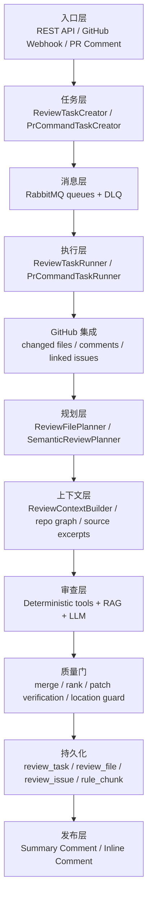
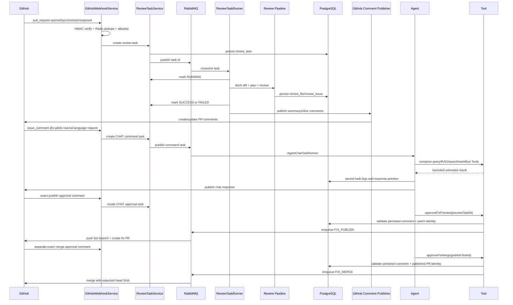

# 架构说明

CodePilot AI 的核心不是把 diff 直接丢给大模型，而是把 PR 审查拆成一条后端流水线：触发、去重、排队、拉取上下文、规划审查重点、并发审查文件、合并结果、证据校验、落库、回写 GitHub。

## 总览



## 模块边界

### 入口层

- `ReviewController` 提供手动创建和查询审查任务的 REST API。
- `GitHubWebhookController` 接收 GitHub Webhook。
- `GitHubWebhookService` 负责开关判断、HMAC 验签、payload 解析、仓库 allowlist、Redis 去重和命令路由。

### 任务层

- `ReviewTaskCreator` 把 PR URL、title、head sha 和评论模式转成 `review_task`。
- `ReviewTaskServiceImpl` 提供创建、查询和处理任务的统一入口。
- `PrCommandTaskCreator` 把所有 `@x-pilotx ...` 自然语言评论转成 `CHAT` Agent 任务；只有无 mention 的兼容命令 `/review` 直接创建 Review Workflow。

### 消息层

- `ReviewTaskProducer` / `ReviewTaskConsumer` 使用 RabbitMQ 投递和消费审查任务。
- `PrCommandTaskProducer` / `PrCommandTaskConsumer` 使用独立队列处理 PR 命令任务。
- `RabbitMqConfig` 为两类任务都配置 durable queue、direct exchange 和 dead-letter queue。
- Spring AMQP listener 并发由 `CODEPILOT_RABBITMQ_LISTENER_CONCURRENCY`、`CODEPILOT_RABBITMQ_LISTENER_MAX_CONCURRENCY`、`CODEPILOT_RABBITMQ_LISTENER_PREFETCH` 控制。

### 执行层

- `ReviewTaskRunner` 统一推动任务状态：RUNNING -> SUCCESS/FAILED。
- `ReviewTaskProcessor` 负责拉取 changed files、规划文件、清理旧 issue、执行审查并保存结果。
- `ReviewTaskFailureHandler` 统一处理失败、脱敏错误信息，并结合 RabbitMQ retry attempt 判断最终失败。

### 规划和上下文层

- `ReviewFilePlanner` 按文件大小、patch 预算、路径风险和文件类型决定哪些文件进入审查。
- `SemanticReviewPlanner` 汇总风险面，生成 priority files、file focus、cross-file focus 和 verification hints。
- `ReviewContextBuilder` 组合 file summary、语义信号、关联 patch、PR linked issues、仓库图谱和相关源代码片段。
- `RepositoryGraphSnapshotBuilder` 和 `RepoSourceExcerptExtractor` 支持跨文件上下文召回。

### 审查层

- `DeterministicReviewToolRunner` 调用确定性规则工具。
- `SqlRiskTool`、`SecretScanTool`、`TestSuggestionTool` 覆盖 SQL、敏感信息和测试缺失风险。
- `ReviewRagServiceImpl` 召回规则文档，并由 `ReviewRagCache` 做 TTL + LRU 缓存。
- `ReviewPromptBuilder` 和 `AiReviewContextFormatter` 组装受约束的审查 prompt。
- `LangChain4jReviewLlmClient` 调用 OpenAI-compatible 模型。

### 质量门

- `ReviewResultMerger` 合并 deterministic tool 和 LLM 输出。
- `ReviewIssuePatchVerifier` 要求 LLM issue 尽量绑定 changed line、patch token、review plan evidence 或高信号风险面。
- `ReviewIssueLocationGuard` 判断 issue 是否能落到可评论 diff 行。
- `ReviewFindingRanker` 负责评分、去重、预算和发布顺序。

### 发布层

- `ReviewCommentPublisher` 统一发布 GitHub 评论。
- `GitHubCommentServiceImpl` 使用 marker 幂等创建/更新 Summary Comment。
- `GitHubInlineCommentServiceImpl` 使用 issue fingerprint 避免重复 inline comment。
- inline 发布失败或不可定位时，系统仍可通过 Summary Comment 保留审查结果。

### Agent Chat 层

- `ChatCommandHandler` 只负责校验评论入口、创建 `CHAT` 类型的 `pr_command_task`；任务先写入 command outbox，再由后台发布器可靠投递 RabbitMQ。
- `AgentChatTaskRunner` 在消费者线程中加载最新 review session context，调用带 Tool 的 LangChain4j Assistant，并将最终回复发布到 GitHub。
- `AgentTaskTraceContext` 将当前 command task id 绑定到 Tool 调用线程；`GithubCommandChatTool` 记录 `TOOL_CALL`，任务日志同时记录上下文加载、模型回复和评论发布结果。
- Agent 自主组合 PR 查询、变更摘要、已存 finding、团队规则检索和可选 SearXNG 外部搜索等只读 Tool，也可调用 `startReviewWorkflow` 或 `startFixPreview` 启动受控异步 Workflow。
- `startFixPreview` 从当前持久化 Agent 任务派生仓库和 PR 身份，只允许 `dryRun=true`；Agent 不持有原始 Git/Shell Tool。
- `approveFixPreview` / `approveFixMerge` 只是受控 Workflow 的入口，不是 GitHub 写操作。`FixApprovalService` 从持久化的原评论验证精确命令、同一请求者、仓库/PR、source head SHA、patch SHA-256、允许路径和服务端开关，模型自行调用 Tool 不构成授权。
- `FIX_PUBLISH` 重新应用并校验已批准 patch，推送持久化的随机 `codepilot/fix-*` 分支，再创建以原 PR head 分支为 base 的修复 PR；唯一索引和远程分支/PR 查询保证重试幂等。
- `FIX_MERGE` 使用第二次独立审批，校验修复 PR 非 draft、head/base/commit 与发布任务一致且 `mergeable_state=clean`，再用 expected SHA 调用 GitHub merge API。发布审批不等于合并审批。
- `pr_command_task_outbox` 为 CHAT/FIX/审批动作提供事务内可靠投递；消费者通过 execution token 和 lease 原子领取，租约过期后由 recovery job 恢复，避免重复消息并发执行或 broker 短暂不可用丢任务。
- `AgentRunService` 将一次 Agent 运行拆成 `agent_run` 与 `agent_step`，限制模型轮次、Tool 调用数、continuation 次数和总截止时间；异步 Workflow 会把运行置为 `WAITING_WORKFLOW`，完成后恢复为待执行。
- 跨评论上下文只加载同一 repo/PR 的有限成功 CHAT 任务，并作为不可信数据注入；不参与审批或 Tool 作用域决策。
- `fetchWebDocument` 只允许当前 Agent run 最近一次 `searchWeb` 返回的 HTTPS URL，且要求显式域名白名单并执行私网 DNS、响应大小、内容类型和重定向防护。

## 典型执行链路



## 并发模型

项目有两层并发：

1. 任务级并发：RabbitMQ listener 可以并发消费多个 review task 或 PR command task。
2. 文件级并发：单个 review task 内，`ReviewFileReviewExecutor` 使用 `CompletableFuture` 和 `reviewFileExecutor` 并发审查多个文件。

关键配置：

```env
CODEPILOT_RABBITMQ_LISTENER_CONCURRENCY=2
CODEPILOT_RABBITMQ_LISTENER_MAX_CONCURRENCY=4
CODEPILOT_RABBITMQ_LISTENER_PREFETCH=1
CODEPILOT_REVIEW_MAX_PARALLEL_FILES=2
CODEPILOT_REVIEW_MAX_FILES_PER_TASK=30
```

这样做的目的不是无脑拉高吞吐，而是在 LLM、GitHub API、数据库和队列之间留出可控背压：任务间通过 RabbitMQ 排队，任务内通过文件级并发缩短大 PR 的审查时间。

并发入口可以用 `scripts/concurrency-smoke.ps1` 演示：脚本并发发送同一个 PR/headSha 的 webhook，正常结果是 1 个请求创建或复用审查任务，其余请求被 Redis 去重识别为 `duplicate event`。

## 可靠性设计

- Webhook 层使用 Redis 30 秒 TTL 去重，避免 GitHub 重试或重复 delivery 造成重复审查。
- 任务创建层按 repo/pr/headSha/commentMode 复用已有任务，降低重复 LLM 调用成本。
  - 注意复用要求 `headSha` 非空：`ReviewTaskCreator.findReusableTask` 在 headSha 为空时直接返回 null，
    而 `V9__dedupe_review_task_head_sha.sql` 的唯一索引条件也是 `WHERE head_sha IS NOT NULL`。
  - 因此该复用只对 **Webhook 入口**（`pull_request` payload 自带 head sha）生效。
    `POST /api/reviews` 只传 `prUrl`，创建时 headSha 为 null，head sha 要到消费端
    `ReviewTaskRunner.run()` 调用 `ReviewTaskHeadShaRefresher.refresh` 时才补上。
    结论：**手动 API 重复调用同一个 PR 会创建多个任务**，这是当前实现的行为，不是幂等缺口被漏掉。
- 创建审查任务时在同一数据库事务写入 `review_task_outbox`，后台发布器通过 RabbitMQ Publisher Confirm 确认投递；失败按指数退避重试，发布锁超时后可再次领取。
- 消费者通过条件更新原子领取任务并写入执行令牌和租约，重复消息只能有一个执行者；实例宕机后，过期租约会恢复为待执行并重新投递。
- RabbitMQ retry + DLQ 保存最终消费失败消息，便于排查。
- 文件与问题先在内存完成规划，成功后在短事务内原子替换旧结果并将任务置为成功，避免失败重试留下半套结果。
- GitHub 评论发布使用独立状态机和有限重试，发布失败不会把已经完成的审查改成失败。
- GitHub 评论发布中的 `PUBLISHING` 状态带超时恢复，进程中断后可以重新领取；达到最大尝试次数后进入终态，避免无限重试。
- 单文件审查失败不会直接拖垮整次 PR 审查。
- GitHub Summary Comment 使用 marker 幂等更新，避免 PR Conversation 被重复刷屏。
- GitHub inline comment 使用 fingerprint 去重。
- LLM cache 和 RAG cache 降低重复审查成本。

## 安全边界

- REST API 默认 API Key 保护。
- REST API 默认固定窗口限流。
- GitHub Webhook 必须 HMAC 验签。
- GitHub 仓库 allowlist 控制可处理范围。
- GitHub App 模式使用短期 installation token，生产优先于 PAT。
- fix 模式默认关闭。
- fix validation 默认只允许 `git diff --check`，不通过 shell 执行命令。
- 构建类命令必须显式开启 Docker sandbox，并且默认无网络、不继承应用敏感环境变量。
- 日志和错误信息会经过敏感信息脱敏。

## 数据模型

核心表：

- `review_task`：一次 PR 审查任务，包含 repo、prNumber、headSha、状态、风险等级和统计信息。
- `review_task_outbox`：审查任务的本地可靠消息，记录发布状态、尝试次数、下次重试时间和发布锁。
- `review_file`：一次审查中的 changed file 记录。
- `review_issue`：最终审查问题，包含 severity、issueType、filePath、lineNumber、source、ruleCode、evidence 等。
- `rule_document`：规则文档原文。
- `rule_chunk`：规则文档切片和 pgvector embedding。
- `pr_command_task`：PR 评论命令任务。
- `pr_command_task_log`：命令执行日志。
- `ai_review_cache`：LLM 审查缓存。
- `llm_call_log`：LLM 调用审计日志。

数据库迁移位于 `src/main/resources/db/migration/`，由 Flyway 在启动时执行。

## 质量验证

自动化测试覆盖：

- Webhook 验签、payload 解析、事件忽略和去重。
- RabbitMQ 配置、retry attempt 和 DLQ。
- API Key 与限流。
- GitHub Client、GitHub App 鉴权、评论回写和 inline comment 去重。
- RAG 检索、缓存、规则切片和 pgvector 工具。
- SQL/Secret/Test deterministic rules。
- Prompt、parser、LLM schema、降级路径。
- patch verification、location guard、finding ranking。
- 自动修复 patch 应用、命令白名单和 sandbox 约束。

当前全量测试基线为 `540 tests, 0 failures, 0 errors`（`mvn clean test`，JDK 21）。启动 Docker 时 `2 skipped`，未启动 Docker 时 `6 skipped`；跳过的用例全部是条件依赖而非失败：4 个需要 Docker、1 个需要操作系统支持符号链接、1 个是 opt-in 的 GitHub 沙箱 E2E。

其中 `ReliableReviewInfrastructureIntegrationTest`（`@Testcontainers(disabledWithoutDocker = true)`）用隔离的 PostgreSQL/pgvector、Redis 和 RabbitMQ 真实容器覆盖：

- `shouldUseRealInfrastructureForClaimOutboxRateLimitAndPublisherConfirm`：真实原子领取、outbox 投递、分布式限流和 Publisher Confirm。
- `shouldDeadLetterRejectedMessagesAndRecoverStalePublicationClaims`：死信路由和 `PUBLISHING` 陈旧状态恢复。
- `shouldRollbackResultReplacementWhenTaskCompletionLosesOwnership`：执行所有权丢失时结果替换事务回滚。
- `shouldUseRealInfrastructureForCommandClaimOutboxAndPublisherConfirm`：PR 命令任务的领取、outbox 和发布确认。

该测试类启动真实 Spring 上下文，因此 Flyway 迁移也会在真实 PostgreSQL 上执行。已在真实 `pgvector/pgvector:pg16`、`redis:7-alpine`、`rabbitmq:3.13-management-alpine` 容器上验证通过（`Tests run: 4, Failures: 0, Errors: 0, Skipped: 0`）。

Actuator `metrics` 端点提供以下低基数业务指标：

- `codepilot.review.task.creation`：新建与复用任务数。
- `codepilot.review.task.queue.wait`：任务从创建到消费者领取的排队时间。
- `codepilot.review.task.duration`：成功、重试和最终失败任务耗时。
- `codepilot.review.task.execution`：执行结果与重复投递跳过次数。
- `codepilot.review.model.file`：文件级模型审查成功数和失败数，可计算模型失败率。
- `codepilot.review.outbox.publish`：本地消息发布成功、重试和最终失败数。
- `codepilot.review.github.publish`：GitHub 评论成功、跳过、重试和最终失败数。
- `codepilot.review.llm.cache`：**应用级** LLM 响应缓存的命中 / 未命中次数（tag `result=hit|miss`）。
- `codepilot.review.rag.cache`：RAG 召回缓存的命中 / 未命中次数（tag `result=hit|miss`）。
- `codepilot.review.llm.tokens`：真实模型调用的 token 数（tag `kind=input|output`）。
- `codepilot.review.cost`：按模型累计的估算金额（tag `model`），**仅在配置了单价后出现**。
- `codepilot.review.cost.status`：成本可算性（tag `status=estimated|unavailable`）；
  `unavailable` 表示缺该模型单价，**不代表金额为 0**。
- `codepilot.agent.model.turns`：Agent 模型轮次计数。
- `codepilot.agent.tool.calls`：Agent Tool 调用计数（tag `result=success|failed`）。
- `codepilot.agent.run.transitions`：Agent run 状态迁移计数（tag `state`）。
- `codepilot.agent.workflow.wait`：等待异步 Workflow 的时长。

> 完整清单、每个指标的含义与"没有 Prometheus 时怎么查"，见 [`observability.md`](observability.md)。
>
> **刻意未暴露的两个指标**（不是遗漏）：`cache_read` / `cache_creation` token tag——当前
> provider 抽象是 LangChain4j 的 `TokenUsage`，只有 input / output / total，拿不到就不发
> （**恒为 0 的序列看起来像"缓存从未命中"，而真相是"不知道"**）；
> 以及内置模型单价表——单价会变，内置一份必然某天变成错的，而错的钱数比没有钱数更可信。
